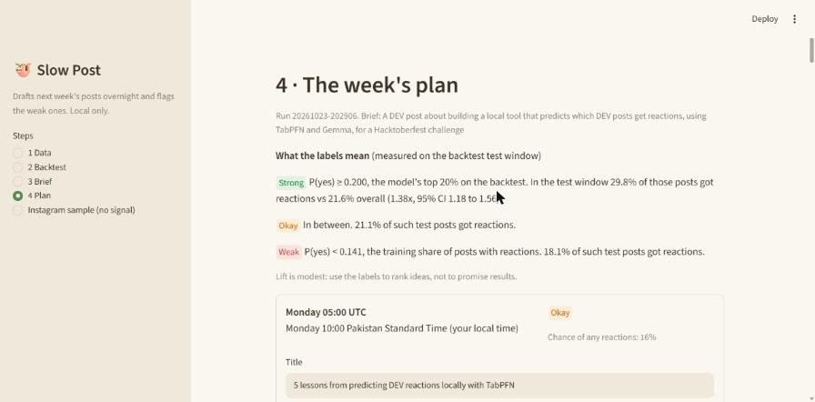

# Slow Post

Slow Post learns from a post history, drafts next week's posts overnight on your laptop with Gemma, and flags the drafts that are likely to underperform with TabPFN. It reports honestly how well that works: every prediction is backed by a time-ordered backtest against a "most common outcome" baseline, and if a history holds no signal, the app says so.

Everything runs locally: no cloud AI, no telemetry. Built for the DEV Hacktoberfest challenge. The demo source is real DEV posts; a public Instagram sample is the "no signal" test case.



Walkthrough (Data, Backtest, Brief, Plan, Download): `docs/slowpost-walkthrough.gif`. More screenshots are in `docs/screenshots/`.

## Headline results

All numbers come from a time-ordered backtest: train on a random sample of up to 1,000 older posts, test on up to 2,000 posts sampled from the newest 7 days. Intervals are 95% bootstrap intervals.

**DEV posts** (44,428 public posts from 10 Aug to 9 Oct 2026, label: "gets any reactions"; 15.6% do):

| | Result |
|---|---|
| Balanced accuracy | 0.544 vs 0.500 for the baseline (gap +0.044, CI +0.019 to +0.070) |
| ROC AUC | 0.588 (CI 0.556 to 0.620; 0.5 is chance) |
| Lift, model's top 10% (200 test posts) | 36.0% got reactions vs 21.6% overall = **1.67x** (CI 1.37 to 1.97) |
| Lift, model's top 20% (400 test posts) | 29.8% got reactions vs 21.6% overall = 1.38x (CI 1.18 to 1.56) |
| Verdict | Better than the baseline. A weak but real signal: use it to rank ideas, not to promise results. |

Raw accuracy is not a good measure here: "always no reactions" would score 78%, so the app reports balanced accuracy, ROC AUC and lift instead.

**Instagram sample** (one account, 1,599 posts, label: thirds of engagement):

| | Result |
|---|---|
| Balanced accuracy | 0.379 vs 0.333 for the baseline (gap +0.045, CI -0.001 to +0.095) |
| ROC AUC | 0.526 (CI 0.479 to 0.573) |
| Signal summary | No feature shows a clear difference after correcting for testing several at once |
| Verdict | **No better than the baseline.** The history has no signal and the app says so. |

## How a run works

1. **Data:** fetch public DEV posts (tags webdev, python, javascript, beginners; posts at least 14 days old).
2. **Backtest:** TabPFN is fitted on older posts and tested on the newest week. The result includes a signal summary: which features (cover image, tags, hour, title, and so on) show a clear difference.
3. **Brief:** write what the posts are about, plus optional facts about your project. Gemma drafts posts (title, up to 4 tags from your history's most common tags, cover idea, outline, reading time, day and hour in UTC and local time). Features are computed by code, never by Gemma.
4. **Plan:** each draft gets Strong, Okay or Weak, with the measured test-window numbers next to the labels. A what-if panel separates "Backed by the data" from "The model's guess". A weak draft is rewritten once, only if a change backed by the data is expected to help.
5. **Download:** edit the cards and download `plan.csv`. Edits are not rescored.

Nothing is ever posted for you.

## Setup (Git Bash on Windows)

Developed and tested on Python 3.14 with [Ollama](https://ollama.com) and roughly 6 GB of free RAM. It runs on CPU. A run takes about 10 minutes for 5 drafts. Gemma and TabPFN never run at the same time.

```bash
git clone git@github.com:Abeera81/slowpost.git
cd slowpost
python -m venv .venv
source .venv/Scripts/activate
pip install -r requirements.txt

ollama pull gemma3:4b          # one time; keep Ollama running (ollama serve, or the app)
```

TabPFN weights are downloaded the first time it runs, after you accept the licence at Prior Labs. If it asks for a token, put it in a `.env` file in the project folder as `TABPFN_TOKEN=...`. `.env` is git-ignored and never printed.

### Run

```bash
source .venv/Scripts/activate
streamlit run app.py                         # the app: Data, Backtest, Brief, Plan

# or step by step
python scripts/fetch_dev_posts.py            # fetch DEV posts into data/dev_posts.csv
python scripts/run_backtest.py --source dev  # backtest + signal summary (about 3 min)
python scripts/run_backtest.py --source instagram   # the "no signal" sample
python scripts/run_overnight.py --brief "..." --facts "..."   # headless run (about 10 min)
python scripts/draft_demo.py --brief "..."   # drafts only
pytest -m "not slow"                         # tests (slow ones need Ollama)
ruff check .
```

## Your data stays on your laptop

- Gemma runs through Ollama on your machine; TabPFN runs with the local `tabpfn` package, never the cloud client. There is no telemetry and no cloud AI.
- The only network calls are fetching public DEV posts and downloading models. After that, the app works offline.
- `data/` (fetched posts, backtests, run outputs) is git-ignored. Only `sample/sample_posts.csv` is committed.
- DEV posts are fetched from the public API, and only these fields are stored: post id, time, title, tags, reading time, cover-image flag, reaction count and comment count. Author names and usernames are never stored. Gemma sees computed summaries, never DEV titles.

## Licences

- **Our code is MIT** (see `LICENSE`).
- **TabPFN model weights have their own licence, and they are non-commercial.** Read Prior Labs' current terms before using Slow Post with them for anything commercial. Slow Post does not include or redistribute the weights.
- Gemma is used through Ollama under Google's Gemma terms.
- The Instagram sample is CC BY 4.0 (see credits).

## Credits

- **Instagram Analytics Dataset** by Kundan Sagar Bedmutha, <https://www.kaggle.com/datasets/kundanbedmutha/instagram-analytics-dataset>, licensed [CC BY 4.0](https://creativecommons.org/licenses/by/4.0/). `sample/sample_posts.csv` is one account (`account_id` 15, 1,599 posts) with rows unchanged.
- **DEV posts** come from [DEV's public API](https://developers.forem.com/api) (`https://dev.to/api/articles`), fetched at run time and not redistributed.
- **TabPFN** by Prior Labs, and **Gemma** by Google, run through **Ollama**.
- Built with Claude Code, following the vibe-coding-prompt-template workflow (product requirements, tech design, agent instructions and milestones).

## Changes after the deadline

_None yet._
